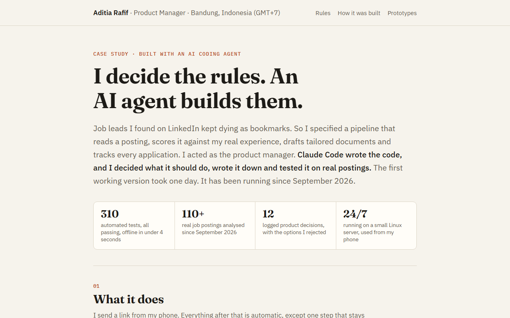
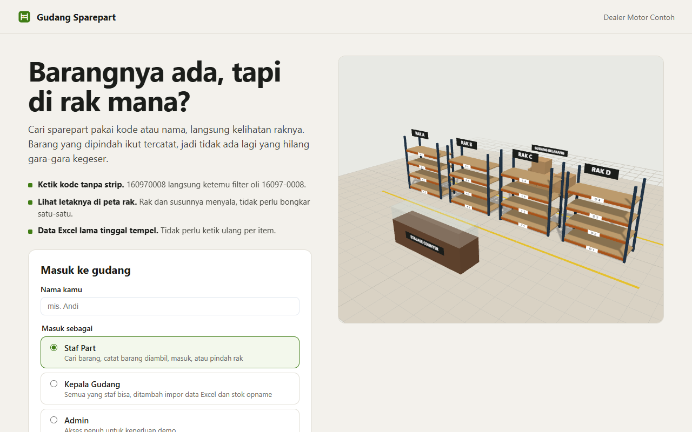
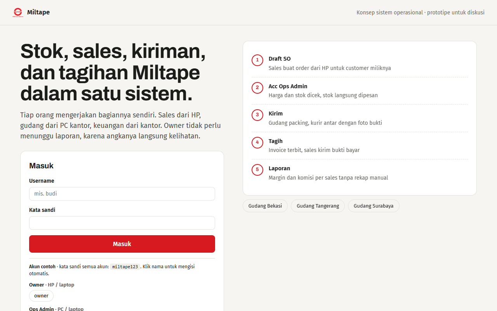

<picture>
  <source media="(prefers-color-scheme: dark)" srcset="assets/banner-dark.svg">
  
</picture>

  
  
  
  
  

## Hi, I'm Adit

I'm a Product Manager with 6+ years of experience, mostly in lending products at **eFishery** and, most recently, school-admission platforms for a **government education agency in Indonesia**.

My work usually covers the whole cycle: translating credit and admission policies into product logic and tools, writing specs with engineers, rolling the product out to its users, and following up on the metrics after launch. I do my own analysis in SQL, and lately I also build prototypes with an AI coding agent.

## What I've shipped

| | |
|---:|:---|
| **900K+** | applicants on two province-scale school-admission platforms I managed in 2026, including one for 41 flagship schools (~39K applicants) |
| **10K+** | customers on eFishery's Kabayan lending product, which I helped take from its first branch to production scale |
| **55 → 22 days** | internal credit SLA after rolling out an early Loan Origination System |
| **IDR 180B** | added to the loan book through P2P and banking partner integrations |
| **USD 1.7M** | revenue through transaction tools I launched for eFishery's international branch |
| **40% → 17%** | over-limit orders in B2B shrimp financing, after reworking onboarding and transaction tools |

Client details for the public-sector work are available on request.

## Prototypes

Built with an AI coding agent: I wrote the specs and tested the results, the agent wrote the code. All three are live.

<table>
  <tr>
    <td width="33%" valign="top">
      
      <h4><a href="https://aditrapip.github.io/built-with-ai/">Job pipeline bot</a></h4>
      
A Telegram bot that reads a job post, scores it against my real experience with a weighted rubric, flags scam signals, and drafts documents only after I say <code>go</code>.

      
310 tests · 110+ real postings · running 24/7 since Sep 2026

    </td>
    <td width="33%" valign="top">
      
      <h4><a href="https://aditrapip.github.io/trial-store-management/">Spare-parts warehouse</a></h4>
      
Search a part by code and see its exact rack on a 3D map. Every move is logged, so moved parts can be traced. Staff, warehouse head and admin each see different actions.

      
Prototype · sample data · Indonesian UI

    </td>
    <td width="33%" valign="top">
      
      <h4><a href="https://aditrapip.github.io/miltape-konsep/">Distributor operations</a></h4>
      
One system for a distributor with three warehouses: sales order, approval, dispatch with photo proof, invoice, and an owner summary.

      
Prototype · sample data · Indonesian UI

    </td>
  </tr>
</table>

## What I'm working on now

- **Tulen**, a small product, systems and AI team (three of us) that helps Indonesian SMEs digitise their operations, such as stock, orders and manual records.
- **A live-prototyping workflow** with my team, where a client's requirements become a clickable browser prototype during the meeting.
- **Open to Product Manager roles** in fintech, govtech or B2B operations.

## How I work

- **Written decisions.** Before building, I write down the product decisions and the options we rejected, so the reasoning is easy to trace later.
- **Rollout and adoption.** I've rolled out tools to credit analysts, branch coordinators and finance teams, written SOPs, and joined field research to check usability.
- **Following up on metrics.** For example, unresolved sales orders dropped from 100% to 3% after fixing product tagging and data structure, and over-limit orders from 40% to 17% after reworking the onboarding and transaction workflow.
- **Explainable scoring.** When a score drives a decision, I prefer a formula that can be explained line by line.
- **Data integrity.** On public admission data, I ran proactive integrity audits directly on the database.
- **Limited resources.** I was the only PM assigned to eFishery India, with limited engineering and design support.

## Toolbox

**Product & delivery** 
     

**Data & operations** 
   

**Building prototypes with an AI agent** 
     

## Background

**Bachelor of Computer Science**, Telkom University · **10x1000 Tech for Inclusion**, fintech foundation program by IFC × Ant Group, Singapore

<b>Career at a glance</b>

 

| When | Role | Where |
|---|---|---|
| 2026 – Aug 2026 | Product Consultant, public admission systems | Government education agency, Indonesia (consulting) |
| 2022 – 2025 | Product Manager | eFishery: B2B financing, eFishery India |
| 2020 – 2022 | Associate Product Manager | eFishery: Kabayan B2C lending |
| 2019 – 2020 | Product Intern | eFishery: first Kabayan branch |

## Activity

---

I can walk through the job-pipeline code and plan on a call. Reach me via LinkedIn or email.

